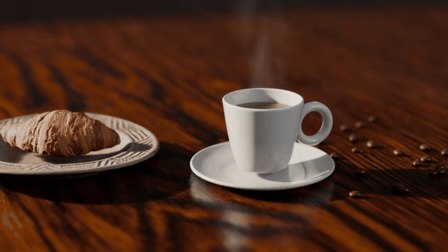
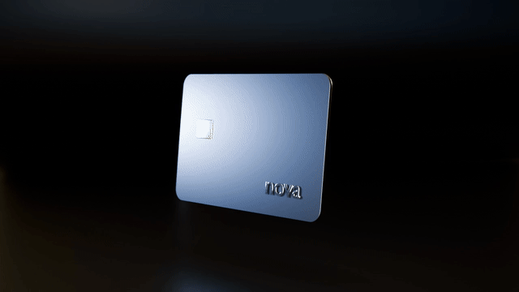

# Mashhad · مشهد

**Cinematic 3D scroll heroes for any landing page, directed by Claude and rendered free on your own computer.**

No AI video. No credits. No uploads. Your logo stays exact, in any language.

You tell Claude Code what your site is about. It pitches a few scenes, builds the one you pick in
[Blender](https://www.blender.org) with real scanned materials from [Poly Haven](https://polyhaven.com),
looks at its own frames and fixes them like a cinematographer, renders a desktop and a phone version,
and drops a scroll-driven film into your site: one small script, no framework needed.

**[See it scroll →](https://m-alkassem.github.io/mashhad/)**

<table>
<tr>
<td></td>
<td></td>
</tr>
<tr>
<td align="center">Coffee brand: scanned croissant and wood, cup and steam built from code</td>
<td align="center">Fintech launch: everything built from code</td>
</tr>
</table>

Both rendered on a fanless MacBook Air in about 4.5 minutes each (120 frames, desktop and phone versions).

## Install

1. Install [Blender](https://www.blender.org/download/) (free, 4.2 or newer).
2. Add the plugin in Claude Code:

   ```
   /plugin marketplace add M-Alkassem/mashhad
   /plugin install mashhad@mashhad
   ```

3. In your site's folder, ask Claude:

   > Make a cinematic 3D scroll hero for this landing page.

## What it's good at

Products, logos and type, objects on a table, architecture and spaces, abstract materials (glass,
metal, light). It is honest about what it can't do well: people, faces, animals and fluid simulations
are AI video's territory.

## How it works

| Piece | What it does |
|---|---|
| `skills/mashhad/SKILL.md` | The director's playbook Claude follows: pitch, build, critique, render, ship |
| `skills/mashhad/kit/mashhad_kit.py` | Building blocks for Blender: looks, lights, materials, haze, steam, dust, camera moves, logo and model import, Poly Haven assets |
| `skills/mashhad/scripts/mashhad.py` | `doctor`, `build`, `preview`, `render`, `sheet`, `pack` |
| `skills/mashhad/engine/mashhad-film.js` | A dependency-free `<mashhad-film>` element that plays the frames with the scroll |

The CLI works without Claude too:

```bash
python3 skills/mashhad/scripts/mashhad.py build examples/coffee/scene.py
python3 skills/mashhad/scripts/mashhad.py preview examples/coffee/build/scene.blend
python3 skills/mashhad/scripts/mashhad.py render examples/coffee/build/scene.blend
python3 skills/mashhad/scripts/mashhad.py pack examples/coffee/build site/mashhad/coffee
```

## Examples

| Scene | Look |
|---|---|
| [`examples/coffee`](examples/coffee/scene.py) | Morning sun through a window, a cup with rising steam, a scanned croissant |
| [`examples/fintech-card`](examples/fintech-card/scene.py) | A titanium card turning in a dark studio with coloured rim lights |
| [`examples/gold-type`](examples/gold-type/scene.py) | Gold Arabic calligraphy over black water, light through a mashrabiya |

## Licence

MIT. Poly Haven assets are CC0 and downloaded on first use; Blender is GPL and installed separately.
